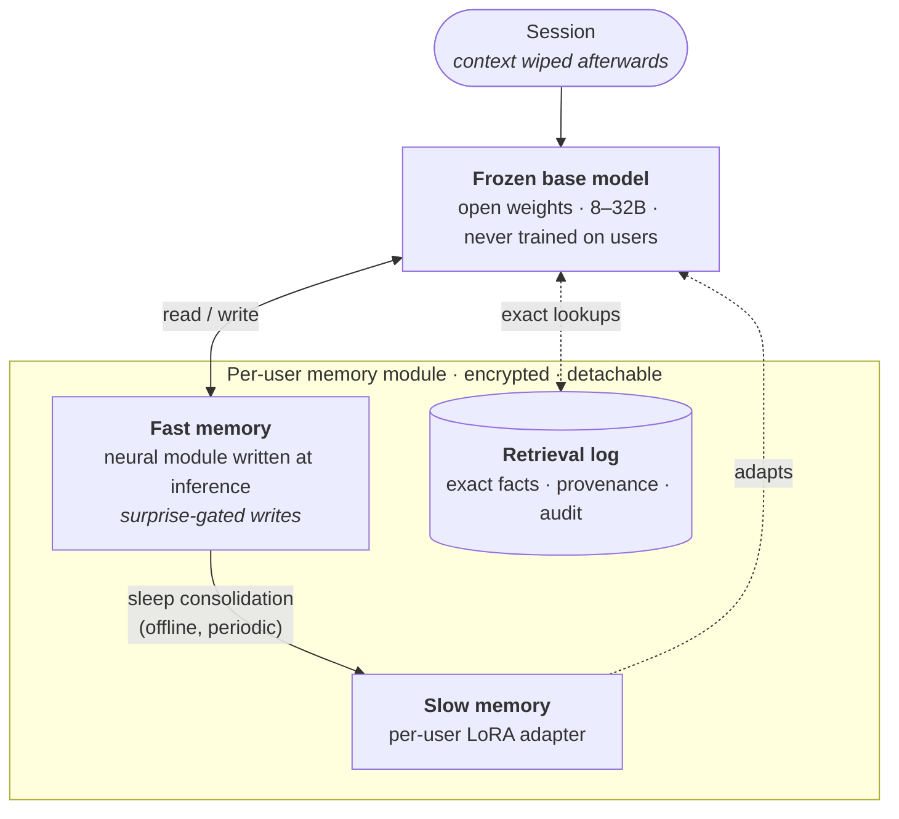

<div align="center">

# Engram

**A language model that remembers you in its weights, not in a prompt.**

[](LICENSE)
[](#status)
[](#roadmap)
[](https://alinaos-org.github.io/engram/)

[Website](https://alinaos-org.github.io/engram/) · [Research](research/landscape.md) · [Eval design](research/eval-design.md) · [Experiment plan](research/experiment-plan.md) · [Phase 0 issues](https://github.com/alinaos-org/engram/milestone/1)

</div>

Engram is an open research project to build a language model whose memory of the person using it is **part of the network itself**, not bolted on in the harness. The goal is a model that learns and keeps knowledge of whoever runs it better than a frontier model with retrieval can, and whose memory of each person lives in a module that person can detach, encrypt or delete.

> **Not to be confused with** DeepSeek's January 2026 "Engram" conditional-memory architecture ([arXiv:2601.07372](https://arxiv.org/abs/2601.07372)). It is unrelated, though relevant; see the [landscape](research/landscape.md#4-memory-layers-and-product-key-memory).

## Why

Today's assistants "remember" by retrieving notes and pasting them back into the prompt. That works for quoting facts, but the model itself never changes:

- Recall depends on a search query matching how something was said.
- Every remembered item costs context on every turn.
- Preferences, habits and past decisions are only used if they were written down *and* retrieved.
- Nothing is learned about *how* a person thinks and works.

Recent work on **test-time training**, **neural memory modules** and **consolidation into weights** suggests memory can live inside the model instead. Engram asks whether that can be made to work for a real person over months, and safely: with per-user isolation, forgetting on request, and deletion that holds up.

## How it works



| Component | What it does | Built on |
|---|---|---|
| **Frozen base model** | Supplies language and world knowledge. It is shared by everyone and never trained on any user, which keeps users isolated. | An open-weights 8–32B model (chosen in Phase 0) |
| **Fast memory** | A small neural memory updated by gradient steps *while the model reads*. Writes are driven by surprise: what the model failed to predict is what it stores. | Titans, test-time training, In-Place TTT |
| **Sleep consolidation** | Periodically and offline, what fast memory learned is distilled into the user's adapter, using synthetic rehearsal and a teacher that has the memories in context. | Cartridges, Knowledge Modules, self-distillation |
| **Per-user adapter** | Slow, durable memory of facts, preferences and ways of working. | LoRA; sparse memory slots under evaluation |
| **Retrieval log** | An append-only record that backs up exact details (numbers, names, dates), records where each memory came from, and lets an adapter be rebuilt from source. | — |
| **Detachable modules** | Fast memory, adapter and log form one encrypted module per user. Deleting a user means destroying their module and key, not scrubbing weights. | — |

## Roadmap

| Phase | Focus | Exit criterion |
|---|---|---|
| **0 · Evals** *(now)* | Build `engram-bench`: multi-session memory with the context wiped between sessions. It covers recall, updates, forgetting and cross-user leakage. Run frontier-plus-retrieval baselines. | The benchmark separates no-memory from full-context, and frontier+RAG leaves real headroom |
| **1 · Memory module** | Attach a test-time-trained memory to a frozen base, continue pretraining on chunked documents, and develop the first sleep recipe. | Beats per-user LoRA on recall after a context wipe; base capabilities unchanged |
| **2 · Synthetic users** | SFT, then RL, on simulated people over months-long timelines, with updates, preference drift and forget requests. | Beats frontier+RAG on preference application and fact updates for held-out users |
| **3 · Private deployment** | Encrypted per-user modules on private hardware, deletion and audit tooling, and a small opt-in pilot. | Passes the deletion audit and an external threat-model review |

Details, hypotheses and compute assumptions are in [research/experiment-plan.md](research/experiment-plan.md).

## Research

| Document | Contents |
|---|---|
| [**Landscape**](research/landscape.md) | Survey of about 90 verified sources: test-time training, Titans and its follow-ups, Nested Learning, memory layers, retrofitting memory onto frozen models, SSMs and hybrids, continual learning, consolidation, per-user LoRA, model editing and unlearning |
| [**Eval design**](research/eval-design.md) | Draft of `engram-bench`: protocol, synthetic users, 12 task categories, forgetting and leakage checks, baselines |
| [**Experiment plan**](research/experiment-plan.md) | Phases 0–3 with hypotheses, decision gates and compute estimates (stated as assumptions) |
| [**Phase 0 plan**](research/phase-0-plan.md) | Gate for entering Phase 1, workstreams, timeline, budget, decisions needed |
| [**Open questions**](research/open-questions.md) | What we don't know yet, ordered by how much the answer could change the design |

**Where the evidence points so far** (October 2026):

- **Fast memory.** Titans-style memory has just been retrofitted onto a frozen pretrained model, but only at 1B ([Titan-Llama](https://arxiv.org/abs/2610.19210)). Gradient-written fast weights help released 4–8B models ([In-Place TTT](https://arxiv.org/abs/2604.06169), [TTT-NTP](https://arxiv.org/abs/2606.21803)). Nobody has yet shown such memory on a frozen 8–32B base that persists across sessions.
- **Consolidation.** Generating synthetic rehearsal data and distilling from an in-context teacher beats training on raw text ([Cartridges](https://arxiv.org/abs/2506.06266), [Knowledge Modules](https://arxiv.org/abs/2503.08727)). Nightly per-user LoRA consolidation kept about 80% of the knowledge in a small 2026 study, against about 37% for context compaction ([Dennis et al.](https://arxiv.org/abs/2605.24657)).
- **Container.** Writing facts into sparse memory slots forgets far less than LoRA ([Sparse Memory Finetuning](https://arxiv.org/abs/2510.15103)), so "facts in slots, style in the adapter" is a live alternative.
- **Deletion.** Gradient unlearning tends to hide data rather than remove it ([Unlearning Isn't Deletion](https://arxiv.org/abs/2505.16831)), so dropping a per-user module is the stronger guarantee. It still has to be verified.

## Status

**Research preview, Phase 0. No model weights yet.** The literature survey, eval design and experiment plan are drafted. The first version of the benchmark harness (`engram-bench`) is in [`engram/`](engram/): synthetic-user generator, probes, scorers, baselines B0/B1/B2/B3, and the cross-user leakage harness. The path to Phase 1 is in [research/phase-0-plan.md](research/phase-0-plan.md), and the work is tracked in [Phase 0 issues](https://github.com/alinaos-org/engram/milestone/1). Nothing here is production-ready, and every compute figure is an assumption until it is measured.

### Quickstart

Requires Python 3.11+ and [uv](https://docs.astral.sh/uv/). Everything below runs on a CPU with no model; mock models stand in.

```bash
uv sync --extra dev
uv run pytest -q
uv run engram-bench generate --out data/bench-v0 --users 50 --sessions 30 --seed 0
uv run engram-bench run --bench data/bench-v0 --system oracle --out runs/oracle
uv run engram-bench run --bench data/bench-v0 --system b3 --mock parrot --out runs/b3-parrot
```

Real models plug in with `--model`:

| Spec | What it runs |
|---|---|
| `claude:claude-opus-5-5` | Claude through the Claude Code CLI, on a Claude subscription |
| `codex:gpt-6.1-sol` | OpenAI through the Codex CLI, on a ChatGPT subscription |
| `Qwen/Qwen3-8B` + `--base-url URL` | any OpenAI-compatible endpoint, such as vLLM; hosted APIs via `--api-key-env VAR` |

Responses are cached in `~/.cache/engram/responses.sqlite`, so interrupted runs resume. The subscription runs isolate the CLIs from your own memories, AGENTS.md and MCP servers; see [`engram/models/subscription.py`](engram/models/subscription.py) for what still reaches the model.

```bash
uv run engram-bench run --bench data/bench-v0 --system b2 --model claude:claude-opus-5-5 --retriever hybrid --no-session-replies --workers 4 --out runs/b2-claude
uv run engram-bench report runs/b2-claude --floor runs/b0-claude
```

Long LLM-written sessions come from `generate --writer long --writer-model …`. `engram-serve` exposes any of these models as a local OpenAI-compatible endpoint, for third-party memory systems such as Mem0 (`--system b5`, `baselines` extra). Dense or hybrid retrieval and the per-user LoRA baseline (`--system b4`) need the `ml` extra: `uv sync --extra dev --extra ml --extra cpu` locally, or `--extra cu130` on a GPU. On NixOS, first run `source scripts/nixos-ml-env.sh`. Public benchmarks are imported with `scripts/fetch-datasets.sh` (LongMemEval, LoCoMo), and `engram-bench judge` grades their free-form answers. GPU runs on AWS follow [docs/aws-gpu.md](docs/aws-gpu.md).

`engram-compute` reproduces the compute assumptions in the experiment plan, so you can change them and re-run; `engram-measure` replaces them with measurements on real hardware.

## Contributing

Contributions are welcome, especially careful reading, sharp questions, and small reproducible experiments. Start with [CONTRIBUTING.md](CONTRIBUTING.md) and the [open issues](https://github.com/alinaos-org/engram/issues). Two rules matter most here:

1. **Cite only what you have opened.** If a claim can't be verified, leave it out.
2. **Never contribute real personal data.** Engram uses synthetic users. Report privacy problems privately via [SECURITY.md](SECURITY.md).

## Citation

If you build on this work, please cite the repository:

```bibtex
@misc{engram2026,
  title        = {Engram: Language Models with Memory in the Network},
  author       = {Mangano, Matthew and {Engram contributors}},
  year         = {2026},
  howpublished = {\url{https://github.com/alinaos-org/engram}},
  note         = {Research preview}
}
```

A [CITATION.cff](CITATION.cff) is included, so GitHub's "Cite this repository" button also works.

## License

[Apache License 2.0](LICENSE).
